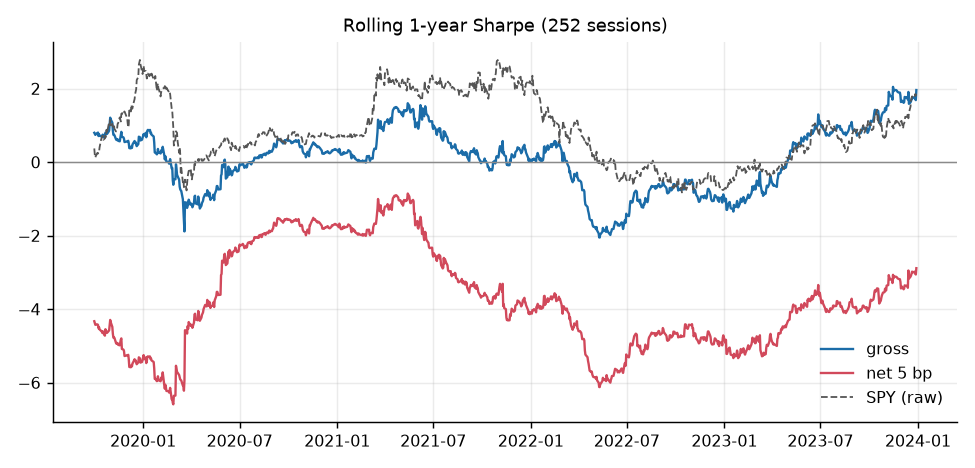
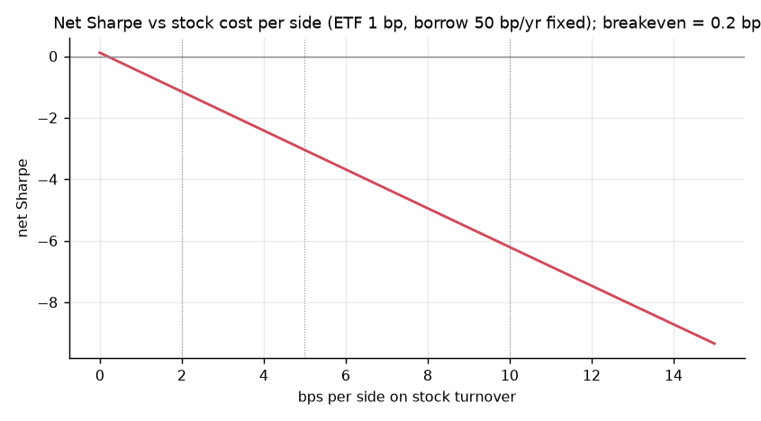
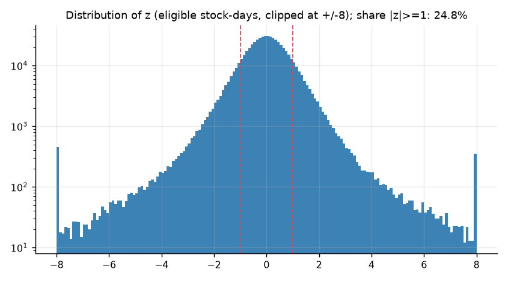
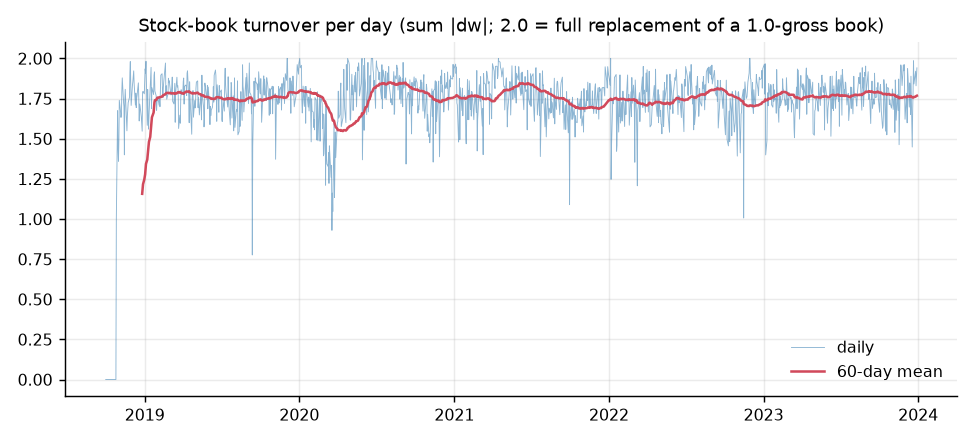
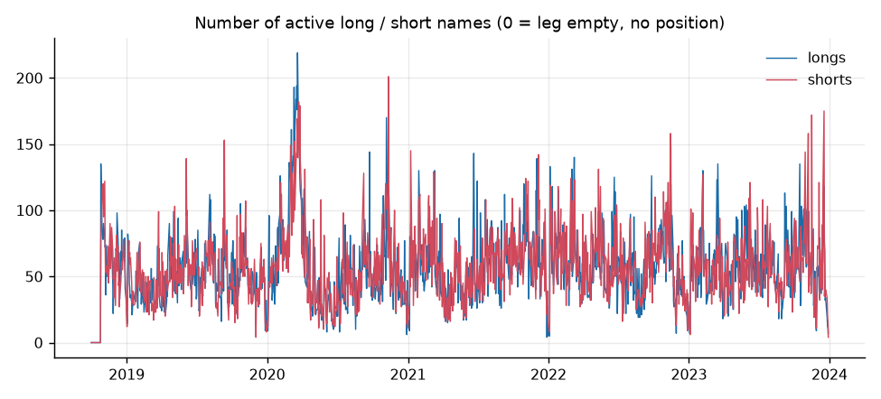
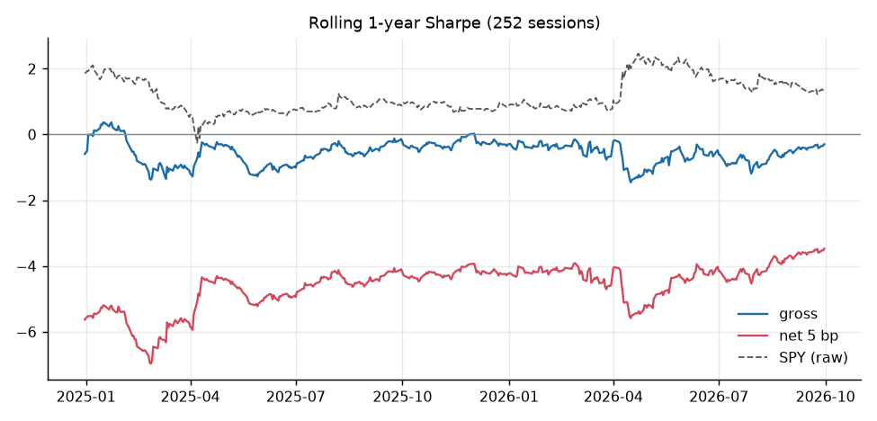
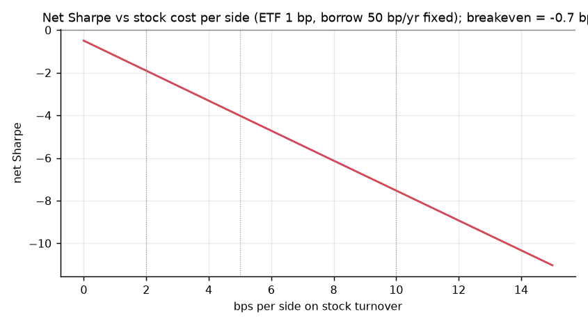
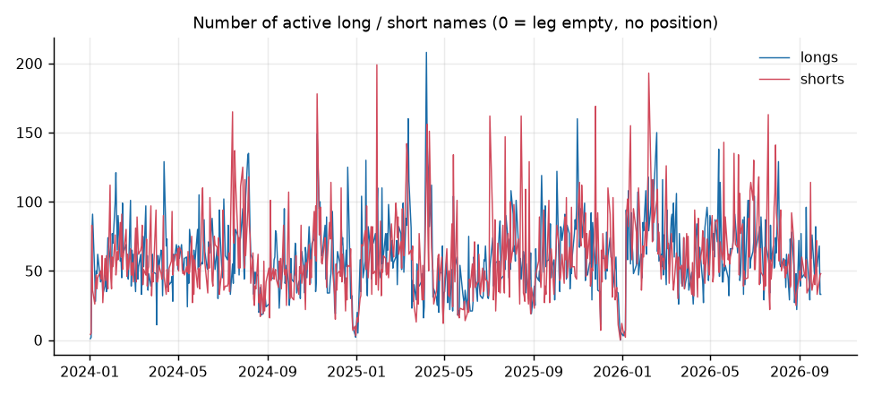

# Results pack: ETF-hedged residual reversion (Holdout Research, strategy 03)

## 0. Verdict (holdout, run once)

**VERDICT: NOT SUPPORTED**  (H1a: fails; H1b: fails)

- H1a: holdout FM mean coefficient -0.0040, Newey-West t = -0.66 (needs negative and t < -2).
- H1b(i): net Sharpe at 5 bp/side = -4.02, 95% stationary-bootstrap CI [-5.38, -2.75] (needs CI entirely above 0).
- H1b(ii): alpha vs SPY = -0.260/yr, NW t = -6.50 (needs t > 2); beta 0.029.
- Gross Sharpe -0.24, CI [-1.46, 1.01].
- Non-gating: Sharpe difference vs SPY buy-and-hold (excess over T-bill) = -5.00, paired-bootstrap 95% CI [-6.95, -3.21]; breakeven cost = -0.71 bp/side; minimum detectable Sharpe for this holdout length = 1.19.

Relative to the pre-registered prior (a detectable gross effect that does not survive costs): the verdict is NOT SUPPORTED. The gross effect was not detectable either (FM t = -0.66; gross Sharpe CI includes 0). Because the minimum detectable Sharpe is 1.19, a true gross Sharpe below that level could not have been detected in this holdout.

Net result: net Sharpe is NEGATIVE at 5 bp per side; the strategy lost money after costs.

## 1. Data summary and coverage

### Stage 0 report

Generated by `scripts/run_stage0_data.py`. Diagnostics cover **2018-06-01 to 2023-12-31 only**; holdout-period prices were split off at download and were not inspected (holdout checks run in Stage 3).

## Sources and conventions

- Prices: Yahoo Finance via `yfinance` (`auto_adjust=False`). `Close` is **split-adjusted but not dividend-adjusted** (true as-traded prices are not available from Yahoo); the $5 filter uses it, so stocks that later split may look cheaper than they were at the time. Returns use `Adj Close`; open-to-open uses `adj_open = Open*AdjClose/Close`.
- Universe: current S&P 500 list from Wikipedia (503 tickers) rolled back with the additions/removals table (https://en.wikipedia.org/wiki/Historical_components_of_the_S%26P_500; the table now lives on the 'Historical components' page, see DEVIATIONS.md). A change takes effect for the session on its effective date.
- Risk-free series for benchmark excess returns: `^IRX` (Yahoo 13-week T-bill yield).

## Survivorship bias

Survivorship bias is **reduced, not eliminated**. Removed stocks (acquired, bankrupt, shrunk) are far less likely than survivors to have Yahoo price history or a Yahoo sector label, so the usable universe is tilted towards survivors. The coverage table below quantifies this by year.

## Coverage by calendar year (average over sessions)

| year | (a) PIT members | (b) with price data | (c) with sector label | (d) usable for trading | flag |
|---|---|---|---|---|---|
| 2018 | 508.0 | 86.0% | 87.6% | 86.0% | **<90%** |
| 2019 | 506.4 | 88.0% | 89.2% | 88.0% | **<90%** |
| 2020 | 506.0 | 90.3% | 91.1% | 90.3% |  |
| 2021 | 506.0 | 91.8% | 92.6% | 91.8% |  |
| 2022 | 504.7 | 93.8% | 94.7% | 93.8% |  |
| 2023 | 504.0 | 95.6% | 96.5% | 95.6% |  |
| 2024 | 504.0 | deferred to Stage 3 | 97.3% | deferred to Stage 3 |  |
| 2025 | 504.0 | deferred to Stage 3 | 98.3% | deferred to Stage 3 |  |
| 2026 | 504.0 | deferred to Stage 3 | 99.6% | deferred to Stage 3 |  |

(b) and (d) for holdout years need holdout prices and are filled in by Stage 3.

## Excluded / problem tickers (point-in-time members during the in-sample window)

- Members in-sample: **613** tickers. With price data: 532. No downloadable prices (excluded, logged): **81**. Priced but no usable sector label (excluded): **0**.
- Full list: `data/processed/ticker_status.csv`; sector sources/mapping: `data/processed/sector_map.csv`, `yahoo_to_gics_mapping.csv`.
- Of the 157 in-sample members that are no longer in the index, 76 are usable (48%), versus 100% of survivors.

No-price tickers:

ABMD, ADS, AET, AGN, ALXN, ANDV, ANSS, APC, ARNC, ATVI, AVB, BMS, CA, CDAY, CELG, CERN, CMA, COL, CTLT, CTRA, CTXS, CXO, DFS, DISCA, DISCK, DISH, DPS, DRE, DWDP, EA, ESRX, ETFC, EVHC, FBHS, FL, FLIR, FLT, FRC, GGP, GPS, HBI, HES, HFC, HOLX, INFO, IPG, JNPR, JWN, K, KSU, LEG, LLL, MON, MRO, MXIM, NBL, NFX, NLSN, PBCT, PXD, QRVO, RHT, RTN, SBNY, SCG, SEE, SIVB, SRCL, TIF, TSS, TWTR, TWX, VAR, VIAB, WBA, WBD, WCG, WLTW, XEC, XL, XLNX

Priced but excluded for sector:

none

## Membership reconstruction issues (5)

Logged, not silently fixed. See `results/membership_reconstruction_issues.csv`.

| date                | ticker   | issue                                       | row                                                                |
|:--------------------|:---------|:--------------------------------------------|:-------------------------------------------------------------------|
| 2026-03-23 00:00:00 | SATS     | undo-add: ticker not in membership          | Market capitalization changes.                                     |
| 2022-04-11 00:00:00 | WBD      | undo-add: ticker not in membership          | WarnerMedia and Discovery merged to create Warner Bros. Discovery. |
| 2022-01-10 00:00:00 | WTW      | possible symbol change (same security name) | Willis Towers Watson changed its ticker symbol from WLTW to WTW.   |
| 2019-06-03 00:00:00 | DD       | possible symbol change (same security name) | DWDP changed to DD after spinning off Corteva.                     |
| 2018-06-20 00:00:00 | FLT      | undo-add: ticker not in membership          | AT&T acquired Time Warner.                                         |

## Price checks (in-sample window)

- Duplicate (ticker,date) rows: **0**.
- Tickers with NaN/zero/negative OHLC rows: **0** (total rows 0). `results/dq_nan_or_nonpositive_prices.csv`.
- Tickers with missing NYSE sessions inside their price history, or dates that are not NYSE sessions: **0**. `results/dq_missing_sessions.csv`.
  - ETFs/benchmark among them: none.
- Single-day |Adj Close return| > 50%: **11** rows (0 coincide with a split flag). `results/dq_moves_gt_50pct.csv`. Nothing was removed or winsorised; flagged observations are used as downloaded.

ticker       date       ret     Close  Adj Close  Stock Splits  split_same_day
   APA 2020-03-09 -0.538647  9.550000   8.071707           0.0           False
  CPRI 2023-08-10  0.557353 53.900002  53.900002           0.0           False
  CVNA 2023-06-08  0.560206  4.846000   4.846000           0.0           False
   FLR 2020-03-19  0.761765  5.990000   5.990000           0.0           False
  HOOD 2021-08-04  0.504060 70.389999  70.389999           0.0           False
  NKTR 2022-03-14 -0.608655 62.400002  62.400002           0.0           False
  NKTR 2023-08-07  0.924528 15.300000  15.300000           0.0           False
   OXY 2020-03-09 -0.520138 12.510000  11.601177           0.0           False
   PCG 2019-01-14 -0.523593  8.380000   8.202487           0.0           False
   PCG 2019-01-24  0.745933 13.950000  13.654500           0.0           False
  TRGP 2020-03-09 -0.529074 13.120000  11.473202           0.0           False

### Holdout addendum (Stage 3)

Window 2024-01-01 to 2026-09-30.

## Coverage by calendar year (all years, average over sessions)

| year | (a) PIT members | (b) with price data | (c) with sector label | (d) usable for trading | flag |
|---|---|---|---|---|---|
| 2018 | 508.0 | 86.0% | 87.6% | 86.0% | **<90%** |
| 2019 | 506.4 | 88.0% | 89.2% | 88.0% | **<90%** |
| 2020 | 506.0 | 90.3% | 91.1% | 90.3% |  |
| 2021 | 506.0 | 91.8% | 92.6% | 91.8% |  |
| 2022 | 504.7 | 93.8% | 94.7% | 93.8% |  |
| 2023 | 504.0 | 95.6% | 96.5% | 95.6% |  |
| 2024 | 504.0 | 96.5% | 97.3% | 96.5% |  |
| 2025 | 504.0 | 97.7% | 98.3% | 97.7% |  |
| 2026 | 504.0 | 99.0% | 99.6% | 99.0% |  |

## Members during the window excluded from trading
- No downloadable prices (21): ANSS, AVB, CDAY, CMA, CTLT, CTRA, DAY, DFS, EA, FLT, HES, HOLX, IPG, JNPR, K, MRO, PXD, QRVO, SATS, WBA, WBD
- Priced but no usable sector label (0): none

## Price checks inside the window
- Duplicate (ticker,date) rows: **0**
- Tickers with NaN/zero/negative OHLC rows: **0**
- Tickers with missing NYSE sessions inside their history / non-session dates: **1** (ETFs/benchmark: none)
- Single-day |Adj Close return| > 50%: **20** rows (0 on a split day). Kept as downloaded.

ticker       date       ret      Close  Adj Close  Stock Splits  split_same_day
   AAP 2025-05-22  0.570425  49.169998  47.716698           0.0           False
    BE 2024-11-15  0.591867  21.139999  21.139999           0.0           False
  ECHO 2025-08-26  0.702477  50.869999  50.869999           0.0           False
    GL 2024-04-11 -0.531402  49.169998  48.114178           0.0           False
  LUMN 2024-08-06  0.930502   5.000000   5.000000           0.0           False
  MRNA 2026-08-19  1.769695 174.380005 174.380005           0.0           False
  NKTR 2025-06-24  1.562893  24.450001  24.450001           0.0           False
  NKTR 2026-02-10  0.510656  56.000000  56.000000           0.0           False
  SBNY 2025-12-09  0.559524   1.310000   1.310000           0.0           False
  SBNY 2026-08-19 -0.562500   0.140000   0.140000           0.0           False
  SBNY 2026-09-25  0.666667   0.300000   0.300000           0.0           False
   STI 2024-03-11  1.258065  87.500000  87.500000           0.0           False
   STI 2024-03-18  0.563218 136.000000 136.000000           0.0           False
   STI 2024-06-18 -0.643523  34.400002  34.400002           0.0           False
   STI 2024-12-27  0.685096  35.049999  35.049999           0.0           False
   STI 2025-05-08  0.680851   7.900000   7.900000           0.0           False
   STI 2025-09-03  1.137195   7.010000   7.010000           0.0           False
   STI 2025-10-13  2.938980  21.625000  21.625000           0.0           False
   STI 2026-06-04  3.505952  22.709999  22.709999           0.0           False
   STI 2026-06-05  0.572876  35.720001  35.720001           0.0           False

Survivorship bias is **reduced, not eliminated**: removed stocks are less likely to have Yahoo prices or sector labels than survivors, so the tested universe over-represents survivors, most strongly in the early years.

## 2. Simulation validation (Stage 1)

| check                                                                               | value                                           | passed   |
|:------------------------------------------------------------------------------------|:------------------------------------------------|:---------|
| 1a planted: mean FM coef within +/-0.02 of -0.10                                    | -0.0984                                         | True     |
| 1a planted: mean gross daily return > 0                                             | 1.43e-03 (positive in 100% of sims)             | True     |
| 1b null: share of sims with FM |t|>2 <= 10%                                         | 3.0%                                            | True     |
| 1b null: share of sims with net-Sharpe CI entirely above 0 <= 10%                   | 0.0%                                            | True     |
| 1c placebo (real in-sample data, wrong-ETF hedge): share of shuffles flagged <= 10% | 0% (median FM t=-1.40, median net Sharpe=-1.60) | True     |
| 1d unit tests (incl. look-ahead tests)                                              | 13 passed in 2.96s                              | True     |

Extra simulation statistics: null_gross_ci_above_zero=0.025, null_mean_fm=-0.000, planted_mean_gross_sharpe=20.193, planted_mean_net_sharpe=7.386, planted_gross_ci_above_zero=1.000, planted_fm_sd=0.002

Placebo (real in-sample data, each stock hedged against a random wrong ETF; 20 shuffles): median FM coef -0.0084 (median NW t -1.40), median gross Sharpe 0.80, median net-5bp Sharpe -1.60; shuffles flagged significant: 0%. Note that a wrong-ETF hedge still removes most market beta, so any generic (non-sector) short-term reversal would also show up here.

## 3. Performance tables

### In-sample (2018-10-01 to 2023-12-31, 1321 sessions)

All P&L is stamped by exit date. Sharpe = mean/std x sqrt(252) of daily returns including flat days, no risk-free subtraction (dollar-neutral book). CI = stationary bootstrap (mean block 10, 10,000 resamples, 95%). Alpha/beta: daily strategy return on SPY open-to-open return, Newey-West 5 lags. `breakeven bp` = per-side stock cost at which mean net return is zero.

**Primary spec (open_open, sector-ETF hedge, |z|>=1, 1-day hold)**

| strategy                                                | costs     |   ann ret |   ann vol |   Sharpe |   CI lo |   CI hi |    MDD |   turnover/day |   avg L |   avg S |   hit |   breakeven bp |   beta SPY |   alpha ann |   alpha NW t |
|:--------------------------------------------------------|:----------|----------:|----------:|---------:|--------:|--------:|-------:|---------------:|--------:|--------:|------:|---------------:|-----------:|------------:|-------------:|
| PRIMARY open_open, sector-ETF hedge, |z|>=1, 1-day hold | gross     |     0.024 |     0.069 |    0.346 |  -0.480 |   1.196 | -0.123 |          1.730 |  56.735 |  57.939 | 0.531 |          0.185 |      0.045 |       0.018 |        0.636 |
| PRIMARY open_open, sector-ETF hedge, |z|>=1, 1-day hold | net_2bps  |    -0.079 |     0.069 |   -1.149 |  -2.004 |  -0.346 | -0.390 |          1.730 |  56.735 |  57.939 | 0.470 |          0.185 |      0.045 |      -0.085 |       -3.048 |
| PRIMARY open_open, sector-ETF hedge, |z|>=1, 1-day hold | net_5bps  |    -0.210 |     0.069 |   -3.047 |  -4.067 |  -2.150 | -0.674 |          1.730 |  56.735 |  57.939 | 0.382 |          0.185 |      0.045 |      -0.216 |       -7.778 |
| PRIMARY open_open, sector-ETF hedge, |z|>=1, 1-day hold | net_10bps |    -0.428 |     0.069 |   -6.204 |  -7.701 |  -4.976 | -0.895 |          1.730 |  56.735 |  57.939 | 0.273 |          0.185 |      0.044 |      -0.434 |      -15.726 |

Diagnostics: 1302 of 1321 sessions in this period held a position. Empty-leg counts (no trade that day) cover ALL signal dates in the data loaded for the run, i.e. warm-up + in-sample + (for the holdout run) holdout: 0 empty-leg day(s) of 1304 (no long leg: 0, no short leg: 0). Position-days with a missing price (0 return assumed): 0.

**Timing variants** (`same_close` is NON-TRADABLE: it enters at the close that generated the signal and is an upper bound only)

| strategy                               | costs     |   ann ret |   ann vol |   Sharpe |   CI lo |   CI hi |    MDD |   turnover/day |   avg L |   avg S |   hit |   breakeven bp |   beta SPY |   alpha ann |   alpha NW t |
|:---------------------------------------|:----------|----------:|----------:|---------:|--------:|--------:|-------:|---------------:|--------:|--------:|------:|---------------:|-----------:|------------:|-------------:|
| close_close_lag                        | gross     |    -0.004 |     0.062 |   -0.070 |  -0.833 |   0.688 | -0.146 |          1.730 |  56.735 |  57.939 | 0.480 |         -0.461 |      0.032 |      -0.009 |       -0.332 |
| close_close_lag                        | net_2bps  |    -0.107 |     0.062 |   -1.723 |  -2.588 |  -0.959 | -0.446 |          1.730 |  56.735 |  57.939 | 0.426 |         -0.461 |      0.032 |      -0.111 |       -4.311 |
| close_close_lag                        | net_5bps  |    -0.238 |     0.062 |   -3.817 |  -4.898 |  -2.918 | -0.719 |          1.730 |  56.735 |  57.939 | 0.353 |         -0.461 |      0.032 |      -0.242 |       -9.326 |
| close_close_lag                        | net_10bps |    -0.456 |     0.063 |   -7.286 |  -8.922 |  -5.991 | -0.910 |          1.730 |  56.735 |  57.939 | 0.263 |         -0.461 |      0.031 |      -0.460 |      -17.509 |
| same_close  [NON-TRADABLE UPPER BOUND] | gross     |     0.034 |     0.069 |    0.493 |  -0.282 |   1.312 | -0.101 |          1.732 |  56.692 |  57.898 | 0.521 |          0.414 |      0.054 |       0.027 |        0.985 |
| same_close  [NON-TRADABLE UPPER BOUND] | net_2bps  |    -0.069 |     0.069 |   -1.008 |  -1.804 |  -0.217 | -0.340 |          1.732 |  56.692 |  57.898 | 0.467 |          0.414 |      0.054 |      -0.076 |       -2.828 |
| same_close  [NON-TRADABLE UPPER BOUND] | net_5bps  |    -0.200 |     0.069 |   -2.913 |  -3.863 |  -2.071 | -0.656 |          1.732 |  56.692 |  57.898 | 0.389 |          0.414 |      0.053 |      -0.207 |       -7.719 |
| same_close  [NON-TRADABLE UPPER BOUND] | net_10bps |    -0.418 |     0.069 |   -6.082 |  -7.394 |  -4.985 | -0.890 |          1.732 |  56.692 |  57.898 | 0.282 |          0.414 |      0.053 |      -0.425 |      -15.926 |

**Pre-registered robustness (non-gating)**

| strategy                                    | costs     |   ann ret |   ann vol |   Sharpe |   CI lo |   CI hi |    MDD |   turnover/day |   avg L |   avg S |   hit |   breakeven bp |   beta SPY |   alpha ann |   alpha NW t |
|:--------------------------------------------|:----------|----------:|----------:|---------:|--------:|--------:|-------:|---------------:|--------:|--------:|------:|---------------:|-----------:|------------:|-------------:|
| (i) SPY-only hedge                          | gross     |     0.051 |     0.089 |    0.576 |  -0.286 |   1.501 | -0.163 |          1.754 |  57.710 |  58.350 | 0.532 |          0.978 |      0.070 |       0.042 |        1.110 |
| (i) SPY-only hedge                          | net_2bps  |    -0.045 |     0.089 |   -0.507 |  -1.417 |   0.368 | -0.290 |          1.754 |  57.710 |  58.350 | 0.491 |          0.978 |      0.070 |      -0.054 |       -1.439 |
| (i) SPY-only hedge                          | net_5bps  |    -0.178 |     0.089 |   -1.993 |  -2.928 |  -1.100 | -0.618 |          1.754 |  57.710 |  58.350 | 0.433 |          0.978 |      0.070 |      -0.187 |       -4.972 |
| (i) SPY-only hedge                          | net_10bps |    -0.399 |     0.089 |   -4.467 |  -5.636 |  -3.420 | -0.879 |          1.754 |  57.710 |  58.350 | 0.344 |          0.978 |      0.069 |      -0.408 |      -10.908 |
| (ii) excl. Visa/Mastercard/PayPal           | gross     |     0.024 |     0.068 |    0.353 |  -0.494 |   1.204 | -0.119 |          1.730 |  56.363 |  57.535 | 0.530 |          0.192 |      0.045 |       0.018 |        0.653 |
| (ii) excl. Visa/Mastercard/PayPal           | net_2bps  |    -0.079 |     0.068 |   -1.153 |  -1.996 |  -0.359 | -0.387 |          1.730 |  56.363 |  57.535 | 0.468 |          0.192 |      0.045 |      -0.085 |       -3.057 |
| (ii) excl. Visa/Mastercard/PayPal           | net_5bps  |    -0.210 |     0.068 |   -3.064 |  -4.105 |  -2.175 | -0.673 |          1.730 |  56.363 |  57.535 | 0.383 |          0.192 |      0.045 |      -0.216 |       -7.819 |
| (ii) excl. Visa/Mastercard/PayPal           | net_10bps |    -0.428 |     0.069 |   -6.242 |  -7.722 |  -5.022 | -0.895 |          1.730 |  56.363 |  57.535 | 0.272 |          0.192 |      0.044 |      -0.433 |      -15.822 |
| (iii) excl. top 10 by 60d avg dollar volume | gross     |     0.026 |     0.069 |    0.369 |  -0.445 |   1.231 | -0.118 |          1.732 |  55.647 |  56.643 | 0.531 |          0.212 |      0.045 |       0.020 |        0.698 |
| (iii) excl. top 10 by 60d avg dollar volume | net_2bps  |    -0.078 |     0.069 |   -1.131 |  -1.991 |  -0.322 | -0.386 |          1.732 |  55.647 |  56.643 | 0.471 |          0.212 |      0.045 |      -0.084 |       -3.011 |
| (iii) excl. top 10 by 60d avg dollar volume | net_5bps  |    -0.209 |     0.069 |   -3.026 |  -4.031 |  -2.126 | -0.673 |          1.732 |  55.647 |  56.643 | 0.384 |          0.212 |      0.045 |      -0.215 |       -7.750 |
| (iii) excl. top 10 by 60d avg dollar volume | net_10bps |    -0.427 |     0.069 |   -6.177 |  -7.686 |  -4.980 | -0.895 |          1.732 |  55.647 |  56.643 | 0.277 |          0.212 |      0.044 |      -0.433 |      -15.711 |

**Benchmarks** (SPY and the equal-weight sector ETFs: Sharpe is on EXCESS returns over `^IRX`/252; the unhedged signal is a dollar-neutral stock book with no ETF leg)

| strategy                                                     | costs     |   ann ret |   ann vol |   Sharpe |   CI lo |   CI hi |    MDD |   turnover/day |   avg L |   avg S |     hit |   breakeven bp |   beta SPY |   alpha ann |   alpha NW t |
|:-------------------------------------------------------------|:----------|----------:|----------:|---------:|--------:|--------:|-------:|---------------:|--------:|--------:|--------:|---------------:|-----------:|------------:|-------------:|
| Unhedged signal (stock book only, no ETF leg)                | gross     |     0.011 |     0.069 |    0.154 |  -0.735 |   1.039 | -0.141 |          1.730 |  56.735 |  57.939 |   0.513 |          0.188 |      0.020 |       0.008 |        0.274 |
| Unhedged signal (stock book only, no ETF leg)                | net_2bps  |    -0.079 |     0.069 |   -1.145 |  -2.063 |  -0.301 | -0.404 |          1.730 |  56.735 |  57.939 |   0.454 |          0.188 |      0.020 |      -0.082 |       -2.818 |
| Unhedged signal (stock book only, no ETF leg)                | net_5bps  |    -0.210 |     0.069 |   -3.039 |  -4.106 |  -2.086 | -0.677 |          1.730 |  56.735 |  57.939 |   0.383 |          0.188 |      0.020 |      -0.212 |       -7.372 |
| Unhedged signal (stock book only, no ETF leg)                | net_10bps |    -0.428 |     0.069 |   -6.190 |  -7.714 |  -4.896 | -0.895 |          1.730 |  56.735 |  57.939 |   0.284 |          0.188 |      0.020 |      -0.430 |      -15.022 |
| SPY buy-and-hold (open-to-open)                              | nan       |     0.131 |     0.198 |    0.567 |  -0.273 |   1.429 | -0.320 |        nan     | nan     | nan     | nan     |        nan     |      1.000 |       0.000 |        2.723 |
| Equal-weight 11 sector ETFs (daily rebalanced, open-to-open) | nan       |     0.122 |     0.193 |    0.534 |  -0.315 |   1.451 | -0.342 |        nan     | nan     | nan     | nan     |        nan     |      0.944 |      -0.002 |       -0.081 |

**EXPLORATORY -- not used to choose anything; many comparisons, expect false positives**

| strategy                                                         | costs    |   ann ret |   ann vol |   Sharpe |   CI lo |   CI hi |    MDD |   turnover/day |   avg L |   avg S |   hit |   breakeven bp |   beta SPY |   alpha ann |   alpha NW t |
|:-----------------------------------------------------------------|:---------|----------:|----------:|---------:|--------:|--------:|-------:|---------------:|--------:|--------:|------:|---------------:|-----------:|------------:|-------------:|
| EXPLORATORY threshold 0.5                                        | gross    |     0.034 |     0.054 |    0.638 |  -0.230 |   1.566 | -0.105 |          1.489 | 123.233 | 124.391 | 0.512 |          0.582 |      0.040 |       0.029 |        1.333 |
| EXPLORATORY threshold 0.5                                        | net_5bps |    -0.166 |     0.054 |   -3.084 |  -4.139 |  -2.189 | -0.584 |          1.489 | 123.233 | 124.391 | 0.375 |          0.582 |      0.040 |      -0.171 |       -8.014 |
| EXPLORATORY threshold 1.5                                        | gross    |     0.037 |     0.086 |    0.427 |  -0.537 |   1.361 | -0.192 |          1.828 |  26.002 |  26.403 | 0.522 |          0.356 |      0.073 |       0.027 |        0.720 |
| EXPLORATORY threshold 1.5                                        | net_5bps |    -0.214 |     0.085 |   -2.503 |  -3.605 |  -1.460 | -0.685 |          1.828 |  26.002 |  26.403 | 0.405 |          0.356 |      0.072 |      -0.223 |       -5.999 |
| EXPLORATORY threshold 2                                          | gross    |     0.048 |     0.109 |    0.438 |  -0.563 |   1.467 | -0.255 |          1.818 |  13.276 |  13.100 | 0.518 |          0.498 |      0.077 |       0.038 |        0.745 |
| EXPLORATORY threshold 2                                          | net_5bps |    -0.206 |     0.109 |   -1.893 |  -2.953 |  -0.788 | -0.694 |          1.818 |  13.276 |  13.100 | 0.431 |          0.498 |      0.076 |      -0.216 |       -4.280 |
| EXPLORATORY hold 2d (overlapping sleeves)                        | gross    |     0.022 |     0.053 |    0.412 |  -0.368 |   1.206 | -0.108 |          0.873 |  95.352 |  97.262 | 0.500 |          0.578 |      0.048 |       0.015 |        0.743 |
| EXPLORATORY hold 2d (overlapping sleeves)                        | net_5bps |    -0.097 |     0.053 |   -1.850 |  -2.843 |  -1.024 | -0.414 |          0.873 |  95.352 |  97.262 | 0.413 |          0.578 |      0.047 |      -0.104 |       -4.999 |
| EXPLORATORY hold 3d (overlapping sleeves)                        | gross    |     0.028 |     0.044 |    0.649 |  -0.176 |   1.466 | -0.088 |          0.586 | 123.538 | 125.654 | 0.513 |          1.475 |      0.040 |       0.023 |        1.299 |
| EXPLORATORY hold 3d (overlapping sleeves)                        | net_5bps |    -0.052 |     0.044 |   -1.188 |  -2.226 |  -0.318 | -0.250 |          0.586 | 123.538 | 125.654 | 0.429 |          1.475 |      0.040 |      -0.057 |       -3.222 |
| EXPLORATORY hold 5d (overlapping sleeves)                        | gross    |     0.021 |     0.035 |    0.616 |  -0.293 |   1.483 | -0.076 |          0.352 | 160.870 | 163.406 | 0.494 |          1.885 |      0.037 |       0.016 |        1.070 |
| EXPLORATORY hold 5d (overlapping sleeves)                        | net_5bps |    -0.028 |     0.035 |   -0.800 |  -1.915 |   0.159 | -0.145 |          0.352 | 160.870 | 163.406 | 0.443 |          1.885 |      0.037 |      -0.032 |       -2.106 |
| EXPLORATORY continuous -z clipped +/-3                           | gross    |     0.024 |     0.055 |    0.433 |  -0.430 |   1.390 | -0.122 |          1.413 | 230.754 | 231.410 | 0.528 |          0.350 |      0.046 |       0.018 |        0.799 |
| EXPLORATORY continuous -z clipped +/-3                           | net_5bps |    -0.166 |     0.056 |   -2.982 |  -3.973 |  -2.142 | -0.584 |          1.413 | 230.754 | 231.410 | 0.375 |          0.350 |      0.046 |      -0.172 |       -7.696 |
| EXPLORATORY excl. |z|>4                                          | gross    |     0.024 |     0.067 |    0.354 |  -0.472 |   1.184 | -0.123 |          1.742 |  54.618 |  56.012 | 0.527 |          0.174 |      0.040 |       0.019 |        0.679 |
| EXPLORATORY excl. |z|>4                                          | net_5bps |    -0.212 |     0.067 |   -3.146 |  -4.184 |  -2.257 | -0.676 |          1.742 |  54.618 |  56.012 | 0.393 |          0.174 |      0.040 |      -0.217 |       -8.014 |
| EXPLORATORY sector Information Technology                        | gross    |    -0.005 |     0.121 |   -0.039 |  -0.823 |   0.733 | -0.310 |          1.699 |   6.815 |   6.886 | 0.499 |         -0.275 |      0.029 |      -0.009 |       -0.166 |
| EXPLORATORY sector Information Technology                        | net_5bps |    -0.226 |     0.121 |   -1.863 |  -2.704 |  -1.060 | -0.730 |          1.699 |   6.815 |   6.886 | 0.437 |         -0.275 |      0.029 |      -0.230 |       -4.480 |
| EXPLORATORY sector Financials                                    | gross    |     0.011 |     0.100 |    0.112 |  -0.728 |   0.924 | -0.195 |          1.683 |   8.788 |   8.978 | 0.500 |          0.054 |      0.043 |       0.006 |        0.139 |
| EXPLORATORY sector Financials                                    | net_5bps |    -0.210 |     0.100 |   -2.093 |  -3.001 |  -1.240 | -0.685 |          1.683 |   8.788 |   8.978 | 0.425 |          0.054 |      0.042 |      -0.215 |       -5.308 |
| EXPLORATORY sector Energy                                        | gross    |    -0.072 |     0.121 |   -0.590 |  -1.365 |   0.211 | -0.441 |          1.393 |   2.881 |   2.863 | 0.482 |         -2.227 |      0.045 |      -0.077 |       -1.506 |
| EXPLORATORY sector Energy                                        | net_5bps |    -0.254 |     0.121 |   -2.092 |  -2.901 |  -1.308 | -0.756 |          1.393 |   2.881 |   2.863 | 0.433 |         -2.227 |      0.045 |      -0.260 |       -5.060 |
| EXPLORATORY sector Health Care                                   | gross    |     0.040 |     0.114 |    0.347 |  -0.468 |   1.188 | -0.132 |          1.718 |   7.021 |   7.290 | 0.523 |          0.762 |      0.034 |       0.035 |        0.720 |
| EXPLORATORY sector Health Care                                   | net_5bps |    -0.183 |     0.114 |   -1.606 |  -2.458 |  -0.800 | -0.676 |          1.718 |   7.021 |   7.290 | 0.455 |          0.762 |      0.033 |      -0.188 |       -3.857 |
| EXPLORATORY sector Consumer Discretionary                        | gross    |     0.055 |     0.152 |    0.364 |  -0.533 |   1.287 | -0.331 |          1.679 |   7.116 |   6.913 | 0.507 |          1.096 |      0.040 |       0.050 |        0.743 |
| EXPLORATORY sector Consumer Discretionary                        | net_5bps |    -0.165 |     0.152 |   -1.087 |  -1.977 |  -0.193 | -0.620 |          1.679 |   7.116 |   6.913 | 0.461 |          1.096 |      0.039 |      -0.170 |       -2.534 |
| EXPLORATORY sector Consumer Staples                              | gross    |     0.010 |     0.118 |    0.087 |  -0.706 |   0.922 | -0.201 |          1.607 |   4.256 |   4.384 | 0.510 |          0.106 |      0.036 |       0.006 |        0.118 |
| EXPLORATORY sector Consumer Staples                              | net_5bps |    -0.198 |     0.118 |   -1.675 |  -2.471 |  -0.878 | -0.685 |          1.607 |   4.256 |   4.384 | 0.459 |          0.106 |      0.036 |      -0.203 |       -4.290 |
| EXPLORATORY sector Industrials                                   | gross    |     0.046 |     0.094 |    0.496 |  -0.360 |   1.367 | -0.174 |          1.732 |   8.733 |   9.175 | 0.511 |          0.901 |      0.032 |       0.042 |        1.080 |
| EXPLORATORY sector Industrials                                   | net_5bps |    -0.179 |     0.094 |   -1.908 |  -2.793 |  -1.049 | -0.641 |          1.732 |   8.733 |   9.175 | 0.434 |          0.901 |      0.031 |      -0.183 |       -4.698 |
| EXPLORATORY sector Materials                                     | gross    |     0.167 |     0.135 |    1.237 |   0.322 |   2.183 | -0.175 |          1.537 |   3.453 |   3.574 | 0.555 |          4.100 |      0.065 |       0.158 |        2.680 |
| EXPLORATORY sector Materials                                     | net_5bps |    -0.035 |     0.135 |   -0.258 |  -1.106 |   0.627 | -0.387 |          1.537 |   3.453 |   3.574 | 0.498 |          4.100 |      0.065 |      -0.043 |       -0.737 |
| EXPLORATORY sector Utilities                                     | gross    |    -0.034 |     0.085 |   -0.394 |  -1.332 |   0.571 | -0.252 |          1.561 |   4.133 |   4.268 | 0.491 |         -0.964 |      0.052 |      -0.040 |       -1.025 |
| EXPLORATORY sector Utilities                                     | net_5bps |    -0.235 |     0.085 |   -2.758 |  -3.772 |  -1.760 | -0.716 |          1.561 |   4.133 |   4.268 | 0.418 |         -0.964 |      0.052 |      -0.241 |       -6.148 |
| EXPLORATORY sector Real Estate                                   | gross    |    -0.035 |     0.120 |   -0.288 |  -1.150 |   0.580 | -0.297 |          1.527 |   4.364 |   4.345 | 0.517 |         -1.039 |      0.036 |      -0.039 |       -0.730 |
| EXPLORATORY sector Real Estate                                   | net_5bps |    -0.232 |     0.120 |   -1.932 |  -2.848 |  -1.064 | -0.721 |          1.527 |   4.364 |   4.345 | 0.447 |         -1.039 |      0.035 |      -0.237 |       -4.414 |
| EXPLORATORY sector Communication Services                        | gross    |     0.018 |     0.147 |    0.121 |  -0.681 |   0.981 | -0.321 |          1.182 |   2.700 |   2.777 | 0.502 |          0.341 |      0.078 |       0.008 |        0.117 |
| EXPLORATORY sector Communication Services                        | net_5bps |    -0.139 |     0.147 |   -0.944 |  -1.735 |  -0.134 | -0.667 |          1.182 |   2.700 |   2.777 | 0.472 |          0.341 |      0.077 |      -0.149 |       -2.295 |
| EXPLORATORY primary spec, first half (2018-10-01 to 2021-05-14)  | gross    |     0.051 |     0.081 |    0.625 |  -0.534 |   1.886 | -0.106 |          1.704 | nan     | nan     | 0.534 |        nan     |      0.039 |       0.044 |        0.941 |
| EXPLORATORY primary spec, first half (2018-10-01 to 2021-05-14)  | net_5bps |    -0.179 |     0.081 |   -2.206 |  -3.540 |  -1.100 | -0.404 |          1.704 | nan     | nan     | 0.390 |        nan     |      0.038 |      -0.186 |       -4.046 |
| EXPLORATORY primary spec, second half (2021-05-17 to 2023-12-29) | gross    |    -0.003 |     0.054 |   -0.059 |  -1.274 |   1.163 | -0.123 |          1.756 | nan     | nan     | 0.528 |        nan     |      0.053 |      -0.008 |       -0.244 |
| EXPLORATORY primary spec, second half (2021-05-17 to 2023-12-29) | net_5bps |    -0.240 |     0.054 |   -4.478 |  -5.638 |  -3.376 | -0.471 |          1.756 | nan     | nan     | 0.374 |        nan     |      0.054 |      -0.245 |       -7.819 |

**Fama-MacBeth** (daily cross-sectional OLS of next-day residual on today's residual, with intercept; mean slope, Newey-West 5-lag t)

| regression                                                            | sector                 |   mean_coef |   nw_se |   nw_t |   n_days |
|:----------------------------------------------------------------------|:-----------------------|------------:|--------:|-------:|---------:|
| close-to-close e(t+1) on e(t)  [primary]                              | ALL                    |      -0.007 |   0.005 | -1.433 |     1303 |
| close-to-close e(t+1) on e(t)  [primary]                              | Information Technology |       0.011 |   0.007 |  1.490 |     1303 |
| close-to-close e(t+1) on e(t)  [primary]                              | Financials             |      -0.010 |   0.008 | -1.360 |     1303 |
| close-to-close e(t+1) on e(t)  [primary]                              | Energy                 |      -0.014 |   0.010 | -1.354 |     1303 |
| close-to-close e(t+1) on e(t)  [primary]                              | Health Care            |      -0.010 |   0.008 | -1.256 |     1303 |
| close-to-close e(t+1) on e(t)  [primary]                              | Consumer Discretionary |      -0.008 |   0.008 | -0.909 |     1303 |
| close-to-close e(t+1) on e(t)  [primary]                              | Consumer Staples       |      -0.006 |   0.009 | -0.677 |     1303 |
| close-to-close e(t+1) on e(t)  [primary]                              | Industrials            |      -0.024 |   0.008 | -3.134 |     1303 |
| close-to-close e(t+1) on e(t)  [primary]                              | Materials              |      -0.031 |   0.010 | -3.215 |     1303 |
| close-to-close e(t+1) on e(t)  [primary]                              | Utilities              |      -0.001 |   0.011 | -0.119 |     1303 |
| close-to-close e(t+1) on e(t)  [primary]                              | Real Estate            |      -0.001 |   0.012 | -0.073 |     1303 |
| close-to-close e(t+1) on e(t)  [primary]                              | Communication Services |      -0.001 |   0.012 | -0.124 |     1291 |
| next-day open-to-open residual (open t+1 -> t+2) on e(t)  [secondary] | ALL                    |      -0.010 |   0.005 | -2.044 |     1302 |
| next-day open-to-open residual (open t+1 -> t+2) on e(t)  [secondary] | Information Technology |       0.005 |   0.008 |  0.694 |     1302 |
| next-day open-to-open residual (open t+1 -> t+2) on e(t)  [secondary] | Financials             |      -0.013 |   0.008 | -1.710 |     1302 |
| next-day open-to-open residual (open t+1 -> t+2) on e(t)  [secondary] | Energy                 |       0.005 |   0.010 |  0.508 |     1302 |
| next-day open-to-open residual (open t+1 -> t+2) on e(t)  [secondary] | Health Care            |      -0.015 |   0.008 | -1.882 |     1302 |
| next-day open-to-open residual (open t+1 -> t+2) on e(t)  [secondary] | Consumer Discretionary |      -0.006 |   0.008 | -0.760 |     1302 |
| next-day open-to-open residual (open t+1 -> t+2) on e(t)  [secondary] | Consumer Staples       |      -0.003 |   0.009 | -0.320 |     1302 |
| next-day open-to-open residual (open t+1 -> t+2) on e(t)  [secondary] | Industrials            |      -0.023 |   0.007 | -3.070 |     1302 |
| next-day open-to-open residual (open t+1 -> t+2) on e(t)  [secondary] | Materials              |      -0.043 |   0.009 | -4.608 |     1302 |
| next-day open-to-open residual (open t+1 -> t+2) on e(t)  [secondary] | Utilities              |       0.005 |   0.012 |  0.412 |     1302 |
| next-day open-to-open residual (open t+1 -> t+2) on e(t)  [secondary] | Real Estate            |      -0.010 |   0.011 | -0.847 |     1302 |
| next-day open-to-open residual (open t+1 -> t+2) on e(t)  [secondary] | Communication Services |       0.000 |   0.012 |  0.031 |     1290 |

**Decision-rule inputs**

| metric                      |   value |
|:----------------------------|--------:|
| fm_mean_coef                |  -0.007 |
| fm_nw_t                     |  -1.433 |
| H1a                         |   0.000 |
| net5_sharpe                 |  -3.047 |
| net5_sharpe_ci_lo           |  -4.056 |
| net5_sharpe_ci_hi           |  -2.151 |
| H1b_i_net_ci_above_zero     |   0.000 |
| alpha_vs_spy_ann            |  -0.216 |
| alpha_nw_t                  |  -7.778 |
| H1b_ii_alpha_t_gt_2         |   0.000 |
| H1b                         |   0.000 |
| gross_sharpe                |   0.346 |
| gross_sharpe_ci_lo          |  -0.497 |
| gross_sharpe_ci_hi          |   1.228 |
| sharpe_diff_vs_spy_buy_hold |  -3.614 |
| sharpe_diff_ci_lo           |  -4.818 |
| sharpe_diff_ci_hi           |  -2.623 |
| breakeven_bps_per_side      |   0.185 |
| min_detectable_sharpe       |   0.856 |

### Holdout (2024-01-01 to 2026-09-30, 689 sessions)

All P&L is stamped by exit date. Sharpe = mean/std x sqrt(252) of daily returns including flat days, no risk-free subtraction (dollar-neutral book). CI = stationary bootstrap (mean block 10, 10,000 resamples, 95%). Alpha/beta: daily strategy return on SPY open-to-open return, Newey-West 5 lags. `breakeven bp` = per-side stock cost at which mean net return is zero.

**Primary spec (open_open, sector-ETF hedge, |z|>=1, 1-day hold)**

| strategy                                                | costs     |   ann ret |   ann vol |   Sharpe |   CI lo |   CI hi |    MDD |   turnover/day |   avg L |   avg S |   hit |   breakeven bp |   beta SPY |   alpha ann |   alpha NW t |
|:--------------------------------------------------------|:----------|----------:|----------:|---------:|--------:|--------:|-------:|---------------:|--------:|--------:|------:|---------------:|-----------:|------------:|-------------:|
| PRIMARY open_open, sector-ETF hedge, |z|>=1, 1-day hold | gross     |    -0.015 |     0.063 |   -0.244 |  -1.466 |   0.964 | -0.144 |          1.770 |  59.624 |  59.660 | 0.493 |         -0.707 |      0.029 |      -0.021 |       -0.526 |
| PRIMARY open_open, sector-ETF hedge, |z|>=1, 1-day hold | net_2bps  |    -0.121 |     0.063 |   -1.906 |  -3.143 |  -0.690 | -0.328 |          1.770 |  59.624 |  59.660 | 0.436 |         -0.707 |      0.029 |      -0.127 |       -3.150 |
| PRIMARY open_open, sector-ETF hedge, |z|>=1, 1-day hold | net_5bps  |    -0.255 |     0.063 |   -4.016 |  -5.393 |  -2.754 | -0.522 |          1.770 |  59.624 |  59.660 | 0.369 |         -0.707 |      0.029 |      -0.260 |       -6.499 |
| PRIMARY open_open, sector-ETF hedge, |z|>=1, 1-day hold | net_10bps |    -0.478 |     0.063 |   -7.527 |  -9.219 |  -6.100 | -0.730 |          1.770 |  59.624 |  59.660 | 0.275 |         -0.707 |      0.029 |      -0.483 |      -12.111 |

Diagnostics: 688 of 689 sessions in this period held a position. Empty-leg counts (no trade that day) cover ALL signal dates in the data loaded for the run, i.e. warm-up + in-sample + (for the holdout run) holdout: 1 empty-leg day(s) of 1993 (no long leg: 1, no short leg: 0). Position-days with a missing price (0 return assumed): 0.

**Timing variants** (`same_close` is NON-TRADABLE: it enters at the close that generated the signal and is an upper bound only)

| strategy                               | costs     |   ann ret |   ann vol |   Sharpe |   CI lo |   CI hi |    MDD |   turnover/day |   avg L |   avg S |   hit |   breakeven bp |   beta SPY |   alpha ann |   alpha NW t |
|:---------------------------------------|:----------|----------:|----------:|---------:|--------:|--------:|-------:|---------------:|--------:|--------:|------:|---------------:|-----------:|------------:|-------------:|
| close_close_lag                        | gross     |     0.011 |     0.059 |    0.189 |  -0.864 |   1.249 | -0.098 |          1.770 |  59.624 |  59.660 | 0.517 |         -0.113 |     -0.025 |       0.016 |        0.510 |
| close_close_lag                        | net_2bps  |    -0.094 |     0.059 |   -1.601 |  -2.693 |  -0.533 | -0.254 |          1.770 |  59.624 |  59.660 | 0.449 |         -0.113 |     -0.025 |      -0.089 |       -2.818 |
| close_close_lag                        | net_5bps  |    -0.228 |     0.059 |   -3.872 |  -5.060 |  -2.744 | -0.471 |          1.770 |  59.624 |  59.660 | 0.387 |         -0.113 |     -0.025 |      -0.223 |       -7.028 |
| close_close_lag                        | net_10bps |    -0.451 |     0.059 |   -7.646 |  -9.091 |  -6.301 | -0.713 |          1.770 |  59.624 |  59.660 | 0.283 |         -0.113 |     -0.025 |      -0.446 |      -13.994 |
| same_close  [NON-TRADABLE UPPER BOUND] | gross     |     0.008 |     0.064 |    0.127 |  -1.082 |   1.368 | -0.144 |          1.770 |  59.673 |  59.699 | 0.509 |         -0.180 |     -0.000 |       0.008 |        0.208 |
| same_close  [NON-TRADABLE UPPER BOUND] | net_2bps  |    -0.097 |     0.064 |   -1.527 |  -2.693 |  -0.375 | -0.281 |          1.770 |  59.673 |  59.699 | 0.458 |         -0.180 |     -0.000 |      -0.097 |       -2.509 |
| same_close  [NON-TRADABLE UPPER BOUND] | net_5bps  |    -0.231 |     0.064 |   -3.628 |  -4.785 |  -2.475 | -0.479 |          1.770 |  59.673 |  59.699 | 0.398 |         -0.180 |     -0.000 |      -0.231 |       -5.993 |
| same_close  [NON-TRADABLE UPPER BOUND] | net_10bps |    -0.454 |     0.064 |   -7.128 |  -8.449 |  -5.858 | -0.710 |          1.770 |  59.673 |  59.699 | 0.289 |         -0.180 |     -0.001 |      -0.454 |      -11.877 |

**Pre-registered robustness (non-gating)**

| strategy                                    | costs     |   ann ret |   ann vol |   Sharpe |   CI lo |   CI hi |    MDD |   turnover/day |   avg L |   avg S |   hit |   breakeven bp |   beta SPY |   alpha ann |   alpha NW t |
|:--------------------------------------------|:----------|----------:|----------:|---------:|--------:|--------:|-------:|---------------:|--------:|--------:|------:|---------------:|-----------:|------------:|-------------:|
| (i) SPY-only hedge                          | gross     |     0.004 |     0.085 |    0.043 |  -1.052 |   1.132 | -0.141 |          1.800 |  61.719 |  61.135 | 0.505 |         -0.165 |      0.054 |      -0.007 |       -0.149 |
| (i) SPY-only hedge                          | net_2bps  |    -0.098 |     0.085 |   -1.162 |  -2.314 |  -0.037 | -0.313 |          1.800 |  61.719 |  61.135 | 0.463 |         -0.165 |      0.054 |      -0.109 |       -2.306 |
| (i) SPY-only hedge                          | net_5bps  |    -0.234 |     0.085 |   -2.771 |  -4.043 |  -1.619 | -0.509 |          1.800 |  61.719 |  61.135 | 0.408 |         -0.165 |      0.054 |      -0.245 |       -5.197 |
| (i) SPY-only hedge                          | net_10bps |    -0.461 |     0.085 |   -5.452 |  -7.063 |  -4.098 | -0.725 |          1.800 |  61.719 |  61.135 | 0.317 |         -0.165 |      0.054 |      -0.472 |      -10.039 |
| (ii) excl. Visa/Mastercard/PayPal           | gross     |    -0.019 |     0.064 |   -0.290 |  -1.501 |   0.929 | -0.147 |          1.770 |  59.247 |  59.273 | 0.491 |         -0.783 |      0.029 |      -0.024 |       -0.596 |
| (ii) excl. Visa/Mastercard/PayPal           | net_2bps  |    -0.124 |     0.064 |   -1.927 |  -3.154 |  -0.670 | -0.335 |          1.770 |  59.247 |  59.273 | 0.436 |         -0.783 |      0.029 |      -0.130 |       -3.167 |
| (ii) excl. Visa/Mastercard/PayPal           | net_5bps  |    -0.258 |     0.064 |   -4.002 |  -5.361 |  -2.766 | -0.528 |          1.770 |  59.247 |  59.273 | 0.368 |         -0.783 |      0.029 |      -0.264 |       -6.442 |
| (ii) excl. Visa/Mastercard/PayPal           | net_10bps |    -0.481 |     0.065 |   -7.455 |  -9.074 |  -6.037 | -0.733 |          1.770 |  59.247 |  59.273 | 0.276 |         -0.783 |      0.030 |      -0.487 |      -11.928 |
| (iii) excl. top 10 by 60d avg dollar volume | gross     |    -0.013 |     0.063 |   -0.211 |  -1.433 |   1.057 | -0.145 |          1.770 |  58.520 |  58.441 | 0.496 |         -0.669 |      0.027 |      -0.019 |       -0.463 |
| (iii) excl. top 10 by 60d avg dollar volume | net_2bps  |    -0.119 |     0.063 |   -1.886 |  -3.148 |  -0.633 | -0.329 |          1.770 |  58.520 |  58.441 | 0.432 |         -0.669 |      0.027 |      -0.124 |       -3.088 |
| (iii) excl. top 10 by 60d avg dollar volume | net_5bps  |    -0.253 |     0.063 |   -4.007 |  -5.391 |  -2.727 | -0.522 |          1.770 |  58.520 |  58.441 | 0.371 |         -0.669 |      0.027 |      -0.258 |       -6.434 |
| (iii) excl. top 10 by 60d avg dollar volume | net_10bps |    -0.476 |     0.063 |   -7.539 |  -9.230 |  -6.062 | -0.730 |          1.770 |  58.520 |  58.441 | 0.275 |         -0.669 |      0.027 |      -0.481 |      -12.062 |

**Benchmarks** (SPY and the equal-weight sector ETFs: Sharpe is on EXCESS returns over `^IRX`/252; the unhedged signal is a dollar-neutral stock book with no ETF leg)

| strategy                                                     | costs     |   ann ret |   ann vol |   Sharpe |   CI lo |   CI hi |    MDD |   turnover/day |   avg L |   avg S |     hit |   breakeven bp |   beta SPY |   alpha ann |   alpha NW t |
|:-------------------------------------------------------------|:----------|----------:|----------:|---------:|--------:|--------:|-------:|---------------:|--------:|--------:|--------:|---------------:|-----------:|------------:|-------------:|
| Unhedged signal (stock book only, no ETF leg)                | gross     |    -0.015 |     0.068 |   -0.220 |  -1.337 |   0.892 | -0.118 |          1.770 |  59.624 |  59.660 |   0.497 |         -0.391 |     -0.013 |      -0.012 |       -0.287 |
| Unhedged signal (stock book only, no ETF leg)                | net_2bps  |    -0.107 |     0.068 |   -1.568 |  -2.680 |  -0.508 | -0.283 |          1.770 |  59.624 |  59.660 |   0.452 |         -0.391 |     -0.013 |      -0.104 |       -2.425 |
| Unhedged signal (stock book only, no ETF leg)                | net_5bps  |    -0.240 |     0.068 |   -3.534 |  -4.708 |  -2.430 | -0.491 |          1.770 |  59.624 |  59.660 |   0.382 |         -0.391 |     -0.013 |      -0.238 |       -5.554 |
| Unhedged signal (stock book only, no ETF leg)                | net_10bps |    -0.464 |     0.068 |   -6.803 |  -8.263 |  -5.551 | -0.718 |          1.770 |  59.624 |  59.660 |   0.283 |         -0.391 |     -0.013 |      -0.461 |      -10.789 |
| SPY buy-and-hold (open-to-open)                              | nan       |     0.198 |     0.158 |    0.982 |   0.000 |   2.176 | -0.198 |        nan     | nan     | nan     | nan     |        nan     |      1.000 |       0.000 |        4.537 |
| Equal-weight 11 sector ETFs (daily rebalanced, open-to-open) | nan       |     0.144 |     0.127 |    0.794 |  -0.143 |   1.993 | -0.162 |        nan     | nan     | nan     | nan     |        nan     |      0.717 |       0.002 |        0.044 |

**EXPLORATORY -- not used to choose anything; many comparisons, expect false positives**

| strategy                                                         | costs    |   ann ret |   ann vol |   Sharpe |   CI lo |   CI hi |    MDD |   turnover/day |   avg L |   avg S |   hit |   breakeven bp |   beta SPY |   alpha ann |   alpha NW t |
|:-----------------------------------------------------------------|:---------|----------:|----------:|---------:|--------:|--------:|-------:|---------------:|--------:|--------:|------:|---------------:|-----------:|------------:|-------------:|
| EXPLORATORY threshold 0.5                                        | gross    |     0.006 |     0.049 |    0.127 |  -1.061 |   1.333 | -0.071 |          1.530 | 130.382 | 128.938 | 0.501 |         -0.172 |      0.022 |       0.002 |        0.058 |
| EXPLORATORY threshold 0.5                                        | net_5bps |    -0.199 |     0.049 |   -4.073 |  -5.532 |  -2.814 | -0.433 |          1.530 | 130.382 | 128.938 | 0.361 |         -0.172 |      0.022 |      -0.204 |       -6.649 |
| EXPLORATORY threshold 1.5                                        | gross    |    -0.013 |     0.082 |   -0.158 |  -1.331 |   1.077 | -0.206 |          1.870 |  26.936 |  27.234 | 0.501 |         -0.703 |      0.049 |      -0.023 |       -0.449 |
| EXPLORATORY threshold 1.5                                        | net_5bps |    -0.269 |     0.082 |   -3.263 |  -4.509 |  -2.032 | -0.565 |          1.870 |  26.936 |  27.234 | 0.403 |         -0.703 |      0.049 |      -0.279 |       -5.503 |
| EXPLORATORY threshold 2                                          | gross    |     0.030 |     0.113 |    0.264 |  -0.853 |   1.453 | -0.192 |          1.867 |  13.314 |  13.195 | 0.525 |          0.096 |      0.086 |       0.013 |        0.187 |
| EXPLORATORY threshold 2                                          | net_5bps |    -0.231 |     0.113 |   -2.036 |  -3.160 |  -0.917 | -0.547 |          1.867 |  13.314 |  13.195 | 0.441 |          0.096 |      0.085 |      -0.248 |       -3.573 |
| EXPLORATORY hold 2d (overlapping sleeves)                        | gross    |    -0.010 |     0.045 |   -0.222 |  -1.286 |   0.870 | -0.102 |          0.894 | 100.875 | 101.441 | 0.491 |         -0.861 |      0.048 |      -0.020 |       -0.781 |
| EXPLORATORY hold 2d (overlapping sleeves)                        | net_5bps |    -0.132 |     0.045 |   -2.906 |  -4.028 |  -1.806 | -0.326 |          0.894 | 100.875 | 101.441 | 0.411 |         -0.861 |      0.048 |      -0.142 |       -5.647 |
| EXPLORATORY hold 3d (overlapping sleeves)                        | gross    |     0.004 |     0.038 |    0.099 |  -0.932 |   1.185 | -0.069 |          0.596 | 131.594 | 132.026 | 0.511 |         -0.200 |      0.044 |      -0.005 |       -0.234 |
| EXPLORATORY hold 3d (overlapping sleeves)                        | net_5bps |    -0.078 |     0.038 |   -2.051 |  -3.129 |  -1.007 | -0.212 |          0.596 | 131.594 | 132.026 | 0.437 |         -0.200 |      0.045 |      -0.087 |       -4.050 |
| EXPLORATORY hold 5d (overlapping sleeves)                        | gross    |     0.004 |     0.031 |    0.144 |  -0.829 |   1.165 | -0.057 |          0.358 | 172.453 | 172.290 | 0.522 |         -0.037 |      0.037 |      -0.003 |       -0.180 |
| EXPLORATORY hold 5d (overlapping sleeves)                        | net_5bps |    -0.045 |     0.031 |   -1.489 |  -2.490 |  -0.514 | -0.142 |          0.358 | 172.453 | 172.290 | 0.466 |         -0.037 |      0.037 |      -0.053 |       -3.180 |
| EXPLORATORY continuous -z clipped +/-3                           | gross    |     0.005 |     0.050 |    0.097 |  -1.084 |   1.282 | -0.081 |          1.444 | 246.907 | 244.144 | 0.499 |         -0.191 |      0.027 |      -0.000 |       -0.014 |
| EXPLORATORY continuous -z clipped +/-3                           | net_5bps |    -0.189 |     0.050 |   -3.792 |  -5.237 |  -2.473 | -0.421 |          1.444 | 246.907 | 244.144 | 0.354 |         -0.191 |      0.026 |      -0.194 |       -6.275 |
| EXPLORATORY excl. |z|>4                                          | gross    |    -0.018 |     0.063 |   -0.292 |  -1.471 |   0.948 | -0.152 |          1.781 |  57.326 |  57.715 | 0.490 |         -0.779 |      0.028 |      -0.024 |       -0.613 |
| EXPLORATORY excl. |z|>4                                          | net_5bps |    -0.259 |     0.063 |   -4.129 |  -5.517 |  -2.870 | -0.528 |          1.781 |  57.326 |  57.715 | 0.363 |         -0.779 |      0.029 |      -0.265 |       -6.814 |
| EXPLORATORY sector Information Technology                        | gross    |    -0.081 |     0.164 |   -0.493 |  -1.670 |   0.643 | -0.381 |          1.742 |   8.413 |   8.305 | 0.489 |         -2.089 |      0.072 |      -0.095 |       -1.024 |
| EXPLORATORY sector Information Technology                        | net_5bps |    -0.311 |     0.164 |   -1.898 |  -3.105 |  -0.747 | -0.653 |          1.742 |   8.413 |   8.305 | 0.435 |         -2.089 |      0.071 |      -0.325 |       -3.519 |
| EXPLORATORY sector Financials                                    | gross    |     0.035 |     0.095 |    0.372 |  -0.727 |   1.450 | -0.113 |          1.755 |   9.130 |   9.516 | 0.537 |          0.581 |     -0.013 |       0.038 |        0.641 |
| EXPLORATORY sector Financials                                    | net_5bps |    -0.195 |     0.095 |   -2.052 |  -3.193 |  -0.956 | -0.459 |          1.755 |   9.130 |   9.516 | 0.445 |          0.581 |     -0.014 |      -0.193 |       -3.278 |
| EXPLORATORY sector Energy                                        | gross    |    -0.059 |     0.110 |   -0.535 |  -1.600 |   0.467 | -0.178 |          1.490 |   3.112 |   3.103 | 0.478 |         -1.750 |      0.044 |      -0.067 |       -1.097 |
| EXPLORATORY sector Energy                                        | net_5bps |    -0.254 |     0.110 |   -2.306 |  -3.379 |  -1.302 | -0.511 |          1.490 |   3.112 |   3.103 | 0.422 |         -1.750 |      0.044 |      -0.262 |       -4.293 |
| EXPLORATORY sector Health Care                                   | gross    |    -0.095 |     0.114 |   -0.835 |  -2.131 |   0.495 | -0.368 |          1.730 |   7.068 |   7.120 | 0.486 |         -2.356 |      0.036 |      -0.102 |       -1.435 |
| EXPLORATORY sector Health Care                                   | net_5bps |    -0.321 |     0.114 |   -2.817 |  -4.079 |  -1.570 | -0.610 |          1.730 |   7.068 |   7.120 | 0.434 |         -2.356 |      0.036 |      -0.328 |       -4.607 |
| EXPLORATORY sector Consumer Discretionary                        | gross    |    -0.020 |     0.131 |   -0.155 |  -1.369 |   1.068 | -0.250 |          1.679 |   6.363 |   6.336 | 0.512 |         -0.698 |      0.052 |      -0.031 |       -0.377 |
| EXPLORATORY sector Consumer Discretionary                        | net_5bps |    -0.241 |     0.131 |   -1.836 |  -3.030 |  -0.661 | -0.531 |          1.679 |   6.363 |   6.336 | 0.463 |         -0.698 |      0.052 |      -0.251 |       -3.098 |
| EXPLORATORY sector Consumer Staples                              | gross    |     0.023 |     0.122 |    0.187 |  -1.109 |   1.416 | -0.266 |          1.671 |   4.682 |   4.449 | 0.488 |          0.404 |      0.031 |       0.017 |        0.212 |
| EXPLORATORY sector Consumer Staples                              | net_5bps |    -0.194 |     0.122 |   -1.581 |  -2.910 |  -0.361 | -0.453 |          1.671 |   4.682 |   4.449 | 0.438 |          0.404 |      0.031 |      -0.200 |       -2.545 |
| EXPLORATORY sector Industrials                                   | gross    |     0.056 |     0.099 |    0.568 |  -0.535 |   1.602 | -0.113 |          1.753 |   9.314 |   9.257 | 0.507 |          1.068 |      0.022 |       0.052 |        0.896 |
| EXPLORATORY sector Industrials                                   | net_5bps |    -0.174 |     0.099 |   -1.757 |  -2.829 |  -0.717 | -0.425 |          1.753 |   9.314 |   9.257 | 0.427 |          1.068 |      0.021 |      -0.178 |       -3.104 |
| EXPLORATORY sector Materials                                     | gross    |    -0.066 |     0.157 |   -0.421 |  -1.431 |   0.634 | -0.257 |          1.598 |   3.423 |   3.428 | 0.511 |         -1.884 |      0.051 |      -0.076 |       -0.828 |
| EXPLORATORY sector Materials                                     | net_5bps |    -0.277 |     0.158 |   -1.759 |  -2.760 |  -0.736 | -0.559 |          1.598 |   3.423 |   3.428 | 0.453 |         -1.884 |      0.050 |      -0.287 |       -3.119 |
| EXPLORATORY sector Utilities                                     | gross    |     0.221 |     0.152 |    1.455 |   0.124 |   2.765 | -0.157 |          1.555 |   4.477 |   4.463 | 0.561 |          5.430 |     -0.087 |       0.238 |        2.546 |
| EXPLORATORY sector Utilities                                     | net_5bps |     0.017 |     0.152 |    0.111 |  -1.179 |   1.361 | -0.315 |          1.555 |   4.477 |   4.463 | 0.496 |          5.430 |     -0.087 |       0.034 |        0.367 |
| EXPLORATORY sector Real Estate                                   | gross    |    -0.029 |     0.103 |   -0.282 |  -1.620 |   1.068 | -0.285 |          1.614 |   4.193 |   4.204 | 0.484 |         -0.859 |      0.032 |      -0.035 |       -0.522 |
| EXPLORATORY sector Real Estate                                   | net_5bps |    -0.238 |     0.103 |   -2.316 |  -3.721 |  -0.937 | -0.557 |          1.614 |   4.193 |   4.204 | 0.419 |         -0.859 |      0.032 |      -0.245 |       -3.625 |
| EXPLORATORY sector Communication Services                        | gross    |    -0.161 |     0.208 |   -0.775 |  -1.757 |   0.416 | -0.432 |          1.356 |   2.678 |   2.758 | 0.493 |         -5.010 |      0.046 |      -0.170 |       -1.404 |
| EXPLORATORY sector Communication Services                        | net_5bps |    -0.342 |     0.208 |   -1.645 |  -2.573 |  -0.637 | -0.637 |          1.356 |   2.678 |   2.758 | 0.468 |         -5.010 |      0.045 |      -0.351 |       -2.901 |
| EXPLORATORY primary spec, first half (2024-01-02 to 2025-05-15)  | gross    |    -0.025 |     0.058 |   -0.437 |  -2.401 |   1.538 | -0.079 |          1.777 | nan     | nan     | 0.485 |        nan     |      0.026 |      -0.030 |       -0.535 |
| EXPLORATORY primary spec, first half (2024-01-02 to 2025-05-15)  | net_5bps |    -0.265 |     0.058 |   -4.567 |  -6.942 |  -2.481 | -0.303 |          1.777 | nan     | nan     | 0.360 |        nan     |      0.026 |      -0.270 |       -4.817 |
| EXPLORATORY primary spec, second half (2025-05-16 to 2026-09-30) | gross    |    -0.006 |     0.068 |   -0.081 |  -1.580 |   1.578 | -0.105 |          1.764 | nan     | nan     | 0.500 |        nan     |      0.037 |      -0.013 |       -0.237 |
| EXPLORATORY primary spec, second half (2025-05-16 to 2026-09-30) | net_5bps |    -0.244 |     0.068 |   -3.568 |  -5.135 |  -1.996 | -0.315 |          1.764 | nan     | nan     | 0.378 |        nan     |      0.037 |      -0.252 |       -4.457 |

**Fama-MacBeth** (daily cross-sectional OLS of next-day residual on today's residual, with intercept; mean slope, Newey-West 5-lag t)

| regression                                                            | sector                 |   mean_coef |   nw_se |   nw_t |   n_days |
|:----------------------------------------------------------------------|:-----------------------|------------:|--------:|-------:|---------:|
| close-to-close e(t+1) on e(t)  [primary]                              | ALL                    |      -0.004 |   0.006 | -0.655 |      689 |
| close-to-close e(t+1) on e(t)  [primary]                              | Information Technology |       0.002 |   0.011 |  0.166 |      689 |
| close-to-close e(t+1) on e(t)  [primary]                              | Financials             |      -0.026 |   0.012 | -2.223 |      689 |
| close-to-close e(t+1) on e(t)  [primary]                              | Energy                 |      -0.005 |   0.014 | -0.356 |      689 |
| close-to-close e(t+1) on e(t)  [primary]                              | Health Care            |       0.003 |   0.012 |  0.212 |      689 |
| close-to-close e(t+1) on e(t)  [primary]                              | Consumer Discretionary |      -0.002 |   0.009 | -0.172 |      689 |
| close-to-close e(t+1) on e(t)  [primary]                              | Consumer Staples       |       0.007 |   0.012 |  0.599 |      689 |
| close-to-close e(t+1) on e(t)  [primary]                              | Industrials            |      -0.010 |   0.009 | -1.080 |      689 |
| close-to-close e(t+1) on e(t)  [primary]                              | Materials              |      -0.005 |   0.014 | -0.336 |      689 |
| close-to-close e(t+1) on e(t)  [primary]                              | Utilities              |      -0.037 |   0.021 | -1.766 |      689 |
| close-to-close e(t+1) on e(t)  [primary]                              | Real Estate            |       0.005 |   0.014 |  0.360 |      689 |
| close-to-close e(t+1) on e(t)  [primary]                              | Communication Services |      -0.017 |   0.019 | -0.902 |      689 |
| next-day open-to-open residual (open t+1 -> t+2) on e(t)  [secondary] | ALL                    |       0.005 |   0.006 |  0.831 |      689 |
| next-day open-to-open residual (open t+1 -> t+2) on e(t)  [secondary] | Information Technology |       0.011 |   0.011 |  1.016 |      689 |
| next-day open-to-open residual (open t+1 -> t+2) on e(t)  [secondary] | Financials             |      -0.010 |   0.011 | -0.893 |      689 |
| next-day open-to-open residual (open t+1 -> t+2) on e(t)  [secondary] | Energy                 |       0.018 |   0.014 |  1.232 |      689 |
| next-day open-to-open residual (open t+1 -> t+2) on e(t)  [secondary] | Health Care            |       0.016 |   0.010 |  1.528 |      689 |
| next-day open-to-open residual (open t+1 -> t+2) on e(t)  [secondary] | Consumer Discretionary |       0.001 |   0.009 |  0.089 |      689 |
| next-day open-to-open residual (open t+1 -> t+2) on e(t)  [secondary] | Consumer Staples       |       0.004 |   0.013 |  0.282 |      689 |
| next-day open-to-open residual (open t+1 -> t+2) on e(t)  [secondary] | Industrials            |      -0.005 |   0.009 | -0.505 |      689 |
| next-day open-to-open residual (open t+1 -> t+2) on e(t)  [secondary] | Materials              |       0.001 |   0.014 |  0.105 |      689 |
| next-day open-to-open residual (open t+1 -> t+2) on e(t)  [secondary] | Utilities              |      -0.050 |   0.021 | -2.413 |      689 |
| next-day open-to-open residual (open t+1 -> t+2) on e(t)  [secondary] | Real Estate            |       0.012 |   0.013 |  0.959 |      689 |
| next-day open-to-open residual (open t+1 -> t+2) on e(t)  [secondary] | Communication Services |       0.010 |   0.019 |  0.560 |      689 |

**Decision-rule inputs**

| metric                      |   value |
|:----------------------------|--------:|
| fm_mean_coef                |  -0.004 |
| fm_nw_t                     |  -0.655 |
| H1a                         |   0.000 |
| net5_sharpe                 |  -4.016 |
| net5_sharpe_ci_lo           |  -5.377 |
| net5_sharpe_ci_hi           |  -2.748 |
| H1b_i_net_ci_above_zero     |   0.000 |
| alpha_vs_spy_ann            |  -0.260 |
| alpha_nw_t                  |  -6.499 |
| H1b_ii_alpha_t_gt_2         |   0.000 |
| H1b                         |   0.000 |
| gross_sharpe                |  -0.244 |
| gross_sharpe_ci_lo          |  -1.463 |
| gross_sharpe_ci_hi          |   1.008 |
| sharpe_diff_vs_spy_buy_hold |  -4.998 |
| sharpe_diff_ci_lo           |  -6.954 |
| sharpe_diff_ci_hi           |  -3.208 |
| breakeven_bps_per_side      |  -0.707 |
| min_detectable_sharpe       |   1.185 |

## 4. Deviations, exclusions and assumptions

Full dated log: `DEVIATIONS.md`.

## 2026-10-27: Source location of the S&P 500 changes table (pre-Stage 1; no parameter change)
The spec names the "Selected changes" table on Wikipedia's "List of S&P 500 companies". On the date of data collection that
page no longer contains the table (only the constituents table); the same additions/removals data (Effective Date, Added,
Removed, Reason) now lives on "Historical components of the S&P 500". `config.yaml: data.wikipedia_changes_url` points there.
Method (working backwards from the current list) is unchanged. Not a modelling change; logged for transparency.

## 2026-10-27: Implementation interpretations fixed before any signal was computed (no parameter change)
Where the spec was silent, these were fixed BEFORE Stage 1 and are part of the pre-registration:
1. beta_t = OLS slope of stock on benchmark return WITH intercept over t-60..t-1; the intercept is then dropped from the residual (e_t = r - beta*r_bench).
2. The z denominator uses the stored historical residual series (each e_s computed with the beta known at s).
3. Min-price filter uses Close_t (the latest close known at signal time t). Yahoo `Close` is split- but not dividend-adjusted.
4. Every P&L/FM observation is stamped by its EXIT / dependent-variable date; the in-sample covers stamps <= 2023-12-31 and the
   holdout stamps >= 2024-01-01. So the first holdout trades use signals from the last in-sample days, and no in-sample
   statistic ever uses a holdout price.
5. Weights are target weights; intra-holding drift is ignored in turnover. Borrow is charged on all short notional (stocks and any short ETF hedge).
6. Held names with a missing price on entry/exit contribute 0 return (counted and reported); no delisting returns exist in the data.
7. Placebo test: each stock hedged against a uniformly random WRONG ETF (20 independent shuffles); a shuffle "fails" if its FM NW t < -2 or its net-5bp Sharpe CI lies entirely above 0; the placebo passes if <= 10% of shuffles fail.
8. Simulation: planted residual AR(1) is on close-to-close residuals; opens = prior close * (1 + overnight_share*r + noise), so open-to-open is not trivially equal to close-to-close.
9. Hit rate = share of ACTIVE days with positive net return. Sharpe uses all session days in the period (flat days count as zero).
10. Benchmarks are measured open-to-open; SPY and sector-ETF excess returns use ^IRX/252 of the previous session.

## 2026-10-27: Per-sector Fama-MacBeth minimum cross-section (reporting code only; config.yaml untouched; found during Stage 2)
The per-sector FM table used the same hard-coded minimum of 20 names per daily cross-section as the overall regression.
That left Communication Services with zero usable days and Energy with 369 (small sectors, 50-day beta + 50-day z warm-up),
so the table was undefined for them. Per-sector rows now use a minimum of 10 names; the OVERALL regression (the one that
enters H1a) still uses 20 and is unchanged (its cross-sections are never that small). This changes only the exploratory
per-sector FM table's coverage, was made because of a NaN table and not because of any estimate, and does not touch the
primary spec, the decision rule or config.yaml. Stage 2 was re-run after the change; the primary results are identical.
No parameter change is proposed on the basis of Stage 2.

## 2026-10-27: Post-holdout reporting fix (no effect on any estimate or on the verdict)
After Stage 3, `primary_diagnostics()` was found to count empty-leg days over every signal date in the loaded data (warm-up +
in-sample + holdout) rather than only the holdout window, so the diagnostics line in the results pack was ambiguous. Only the
WORDING in `src/results_pack.py` was changed to say what is counted; the numbers are unchanged. The Stage 2 (in-sample) run
had 0 empty-leg days, and the Stage 3 run reported 1 over the full sample, so exactly one empty-leg day (no long leg, no trade)
fell in the holdout. The holdout was run exactly once (HOLDOUT_LOCK present); nothing was re-run.

Standing assumptions and exclusions:

- Borrow cost is a flat 50 bp/yr on all short notional; real borrow varies by name and is much higher for hard-to-borrow stocks.
- Sector labels are CURRENT labels applied to the whole sample (e.g. Visa/Mastercard/PayPal were Information Technology until March 2023). Removed tickers are labelled via Yahoo `info` mapped with an explicit table; those without a label are excluded.
- Removed/delisted tickers without Yahoo price history are excluded (logged), so removed stocks are only partially covered.
- Betas are estimated on close-to-close returns and applied to open-to-open holds (and the ETF hedge uses the same betas).
- The $5 filter uses Yahoo `Close`, which is split-adjusted but not dividend-adjusted; true as-traded prices are unavailable.
- No delisting returns; a held name with a missing price contributes 0 return.
- Costs: 5 bp/side stock, 1 bp/side ETF on target-weight changes; no market impact, no capacity limits, no intraday drift modelling; fills are assumed at the open.

## 5. Limitations

- A free-data, long-short daily strategy with ~1.7x daily gross turnover is dominated by trading costs; conclusions about net performance depend almost entirely on the assumed cost levels and fills at the open.
- Yahoo adjusted data can contain errors; flagged >50% moves were kept as downloaded.
- The point-in-time universe is reconstructed from a Wikipedia table that may be incomplete (see reconstruction issues); coverage of removed stocks is partial.
- The holdout is short (about 2.75 years) so only large Sharpe ratios are detectable (see minimum detectable Sharpe); a non-significant result is not evidence of absence.
- Exploratory variants and per-sector results involve many comparisons and were never used to change the primary specification.
- Results are for large-cap US stocks 2018-2026 and may not generalise.
